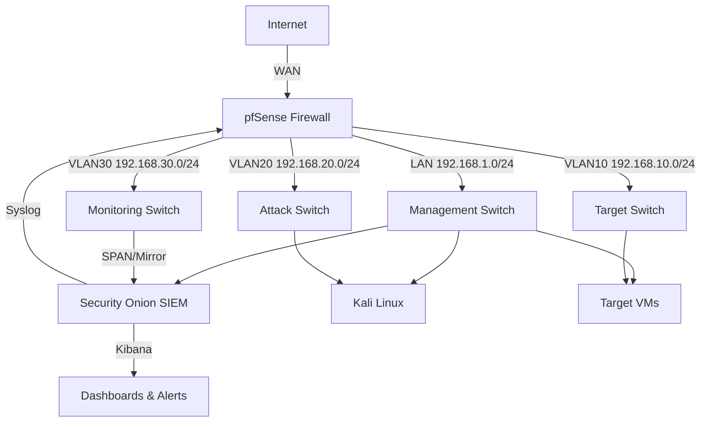

# Home SOC Lab — Architecture

## Network Topology



## Component Details

| Component | Role | IP | VLAN |
|-----------|------|-----|------|
| pfSense | Firewall, NAT, VPN, routing | 192.168.1.1 | LAN |
| Security Onion | SIEM, IDS/IPS, log management | 192.168.1.50 | LAN + VLAN30 (SPAN) |
| Kali Linux | Attack simulation | 192.168.20.10 | VLAN20 |
| Windows Target | Vulnerable target | 192.168.10.10 | VLAN10 |
| Linux Target | Vulnerable target | 192.168.10.11 | VLAN10 |

## Data Flow

1. **Traffic** flows through pfSense (WAN ↔ LAN/VLANs)
2. **SPAN port** mirrors all traffic to Security Onion monitoring NIC
3. **Suricata** inspects packets → alerts to EVE JSON
4. **Zeek** extracts protocol metadata → notices
5. **pfSense syslog** → Security Onion syslog-ng → Logstash → Elasticsearch
6. **Kibana** visualizes alerts, logs, and dashboards
7. **Alerts** trigger on thresholds (Suricata alerts, Zeek notices)

## Detection Pipeline

```
[Packet Capture] → [Suricata IDS] → [EVE JSON] → [Logstash] → [Elasticsearch] → [Kibana]
[Packet Capture] → [Zeek] → [Notice Log] → [Logstash] → [Elasticsearch] → [Kibana]
[pfSense Syslog] → [syslog-ng] → [Logstash] → [Elasticsearch] → [Kibana]
```

## File Structure

```
home-soc-lab/
├── README.md
├── docs/
│   ├── SETUP.md          # Complete setup guide (v2)
│   └── ARCHITECTURE.md   # This file
├── rules/
│   └── suricata/
│       └── custom.rules  # 8 custom detection rules
├── zeek/
│   └── scripts/
│       └── c2_beacon.zeek
├── pfsense/
│   └── config/
│       └── firewall_rules.md
└── templates/
    └── incident_report.md
```

---

*Built by Amdjed Salhi*